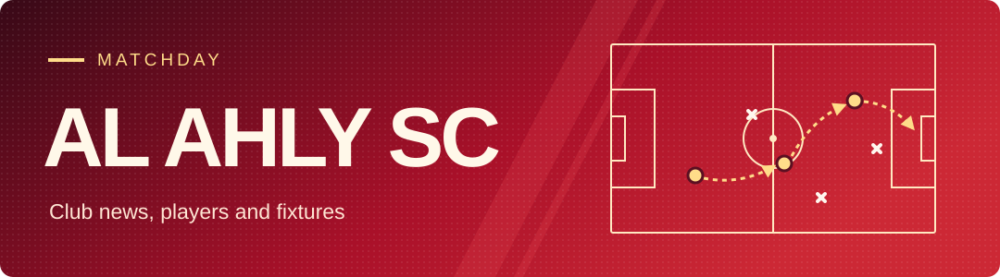
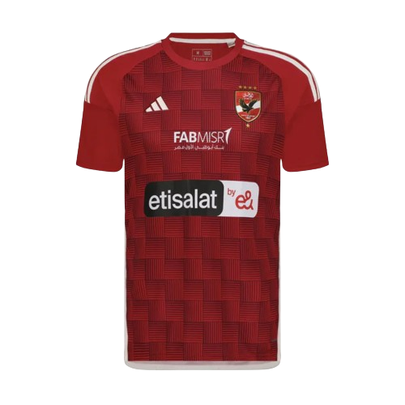
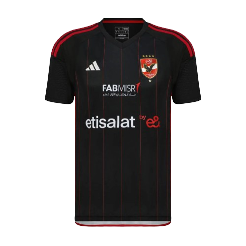
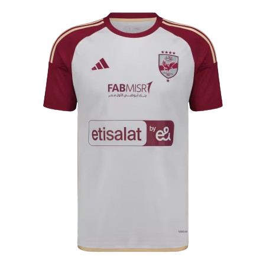

# Al Ahly SC Fan Website

A front-end project for Al Ahly supporters. Start with the club news, meet the players, then explore the fixtures and the Cairo Stadium section.

## The kit room

Three shirts from the website’s shop. Select one for a closer look.

| First kit | Second kit | Third kit |
| :---: | :---: | :---: |
|  |  |  |

## Explore the site

- **Matchday** brings together the monthly fixtures, next match and Cairo Stadium.
- **The squad** features player cards with portraits, names, nationalities and positions.
- **Club media** includes news, a photo gallery and a video section.

## Run locally

Download and extract the repository, then open [`index.html`](index.html) in your browser. The page layout is in [`css/style.css`](css/style.css), and the JavaScript is in [`main.js`](main.js).
